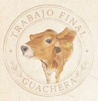

<div align="center">



# Dairy Calf Analytics

### Mortalidad de terneros en guachera: supervivencia y factores de riesgo


Trabajo final de la Diplomatura en Analítica de Datos e Inteligencia de Negocios para el Agro.

</div>

---

## De qué trata

Análisis de la mortalidad de terneros en la guachera de un tambo lechero comercial, combinando registros de crianza con clima diario público.

**Pregunta:** ¿qué factores se asocian con la mortalidad y en qué momento de la vida se concentra el riesgo?

**Tablero de la presentación:** `informe.qmd` · **Tablas y gráficos de respaldo:** `anexo.qmd`

## Enfoque

- Supervivencia (Kaplan-Meier, regresión de Cox) y tasas por etapa de edad.
- Separación de las pérdidas en tres momentos: nacidos muertos, muertes del día del parto y muertes posteriores en la guachera.
- Exposición térmica prenatal (índice temperatura-humedad) y clima diario.
- Causas de muerte anotadas por el veterinario, proporción de sexos y categoría de la madre.
- Tasa de mortalidad mensual con gráfico de control y Random Forest de supervivencia comparado con Cox.
- Pipeline reproducible de validación, anonimización y limpieza.

## Hallazgos principales

- Los terneros se pierden en tres momentos distintos: al nacer, el día del parto y durante la guachera.
- Las muertes del día del parto se concentran en partos asistidos.
- En la guachera, el riesgo se concentra en el primer mes de vida.
- La mortalidad aumentó entre campañas sin que aumentaran los partos, y el aumento se asocia a cuadros diarreicos.
- Ni el sexo, el peso, el tipo de parto, la categoría de la madre ni la exposición térmica explican el aumento; las semanas más frías muestran una señal débil.

El detalle, los gráficos y la discusión están en el informe y en el anexo.

## Datos y privacidad

Los registros de la guachera son privados y están anonimizados; no se incluyen en el repositorio. El clima proviene de [Open-Meteo](https://open-meteo.com/en/docs/historical-weather-api).

## Estructura

```text
calf-analytics/
├── R/
│   ├── prep_modelo.R
│   ├── validaciones.R
│   ├── run_all.R
│   └── scripts/          # pipeline 00–11
├── assets/               # logo e imágenes del tablero
├── data/                 # no versionada
├── reports/
│   ├── figures/
│   └── tables/
├── tests/
├── informe.qmd           # tablero de la presentación
├── anexo.qmd             # tablas y gráficos de respaldo
├── estilo.scss           # estilo del tablero
└── .gitignore
```

## Cómo reproducir

Requiere R (≥ 4.3) y [Quarto](https://quarto.org) (≥ 1.4). Desde la raíz del proyecto:

```r
source("R/run_all.R")
```

Esto corre en orden los scripts de `R/scripts/` (`00_validar` a `11_presentacion`). El paso `03_clima` descarga datos y necesita internet. Después se generan los documentos:

```bash
quarto render informe.qmd
quarto render anexo.qmd
```

Como los datos reales son privados, la reproducción completa requiere el archivo original (`data/raw/guachera.xlsx`).

## Limitaciones

- Datos observacionales de un solo establecimiento: muestran asociaciones, no causalidad.
- No hay registros sistemáticos de calostro, sanidad individual ni causa de muerte confirmada por laboratorio.
- No se registra qué servicios fueron sexados.
- El clima es de un punto de grilla, no del interior de la guachera.

## Autora y licencia

**Beverly J. Licette Gonzalez Casanova** ([@licette32](https://github.com/licette32)) · Licencia MIT. 