```{r}
#| include: false
library(dplyr); library(readr); library(knitr)

a <- read_csv("data/clean/terneros_analisis.csv", show_col_types = FALSE)
p <- filter(a, !aborto)

cox <- read_csv("reports/tables/cox_modelos.csv", show_col_types = FALSE)
lg_nm <- read_csv("reports/tables/logistica_nacidos_muertos.csv", show_col_types = FALSE)
lg_d0 <- read_csv("reports/tables/logistica_muerte_dia0.csv", show_col_types = FALSE)
clima_anual <- read_csv("reports/tables/clima_anual.csv", show_col_types = FALSE)

fmt <- function(x, d = 2) formatC(x, format = "f", digits = d, decimal.mark = ",")
fmt_p <- function(x) ifelse(x < 0.001, "< 0,001", paste("=", fmt(x, 3)))
fmt_or <- function(df) {
  paste0(
    fmt(df$OR), " (", fmt(df$IC_inf), "–", fmt(df$IC_sup), "); p ",
    ifelse(df$p < 0.001, "< 0,001", paste("=", fmt(df$p, 3)))
  )
}
```

## Tabla 1. Pérdidas por año

```{r}
t1 <- p |>
  group_by(anio) |>
  summarise(
    partos = n(),
    nm = sum(nacido_muerto, na.rm = TRUE),
    d0 = sum(muerte_dia0, na.rm = TRUE),
    post = sum(muerte_posterior, na.rm = TRUE),
    .groups = "drop"
  ) |>
  mutate(
    total = nm + d0 + post,
    pct = fmt(100 * total / partos, 1)
  )

kable(
  t1,
  col.names = c(
    "Año", "Partos", "Nacieron muertos", "Murieron día 0",
    "Murieron después", "Pérdidas totales", "Pérdidas (%)"
  ),
  align = "r"
)
```

## Tabla 2. Factores asociados a la mortalidad después del día 0 (Cox, modelo B)

```{r}
etq <- c(
  categoria_madrevaquillona_1er_parto = "Madre: vaquillona (1.er parto) vs. vaca",
  asistidoAsistido = "Parto asistido",
  peso5 = "Peso al nacer (cada +5 kg)",
  sexoMacho = "Sexo: macho",
  anio2024 = "Año 2024 (vs. 2023)",
  anio2025 = "Año 2025 (vs. 2023)",
  thi_media_pre7d = "THI medio, 7 días previos"
)

t2 <- cox |>
  filter(startsWith(modelo, "B"), termino %in% names(etq)) |>
  mutate(
    Factor = unname(etq[termino]),
    `HR (IC 95 %)` = paste0(fmt(HR), " (", fmt(IC_inf), "–", fmt(IC_sup), ")"),
    p_fmt = ifelse(p < 0.001, "< 0,001", fmt(p, 3))
  ) |>
  select(Factor, `HR (IC 95 %)`, p = p_fmt)

kable(t2, align = c("l", "r", "r"))
```

## Tabla 3. Exposición térmica prenatal y pérdidas (OR por cada unidad)

```{r}
etq3 <- c(
  thi_nac = "THI el día del nacimiento",
  thi_media_pre3d = "THI medio, 3 días previos",
  thi_media_pre7d = "THI medio, 7 días previos",
  thi_media_pre21d = "THI medio, 21 días previos",
  tmax_media_pre7d = "Temp. máxima media, 7 días previos",
  hum_media_pre7d = "Humedad media, 7 días previos"
)

nm_prep <- lg_nm |>
  filter(variable %in% names(etq3)) |>
  mutate(`Nacidos muertos` = fmt_or(pick(everything()))) |>
  select(variable, `Nacidos muertos`)

d0_prep <- lg_d0 |>
  filter(variable %in% names(etq3)) |>
  mutate(`Muerte el día 0` = fmt_or(pick(everything()))) |>
  select(variable, `Muerte el día 0`)

t3 <- tibble::tibble(variable = names(etq3), Variable = unname(etq3)) |>
  left_join(nm_prep, by = "variable") |>
  left_join(d0_prep, by = "variable") |>
  select(Variable, `Nacidos muertos`, `Muerte el día 0`)

kable(t3, align = c("l", "r", "r"))
```

## Tabla 4. Clima por año

```{r}
kable(
  clima_anual,
  digits = 0,
  col.names = c("Año", "Lluvia (mm)", "Días con lluvia", "Heladas (≤ 0 °C)", "Días ≤ 5 °C")
)
```

## Gráficos de respaldo

### Evolución y causas

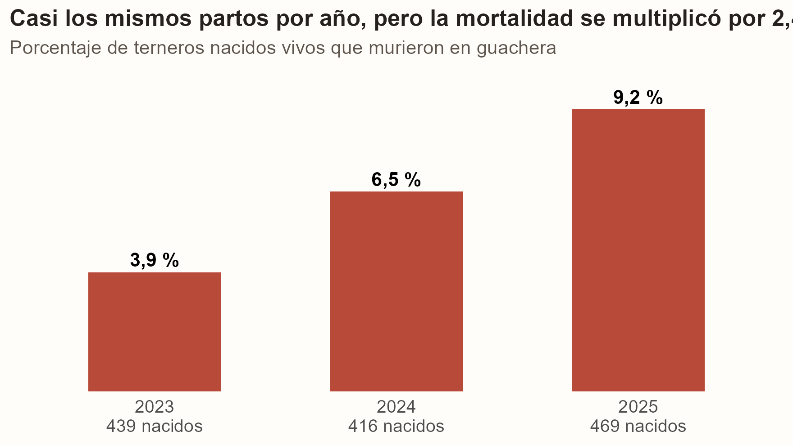
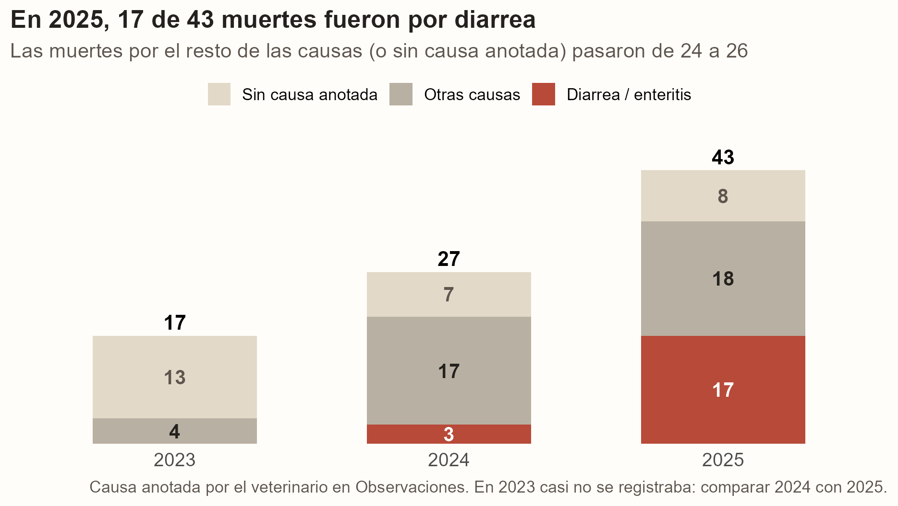
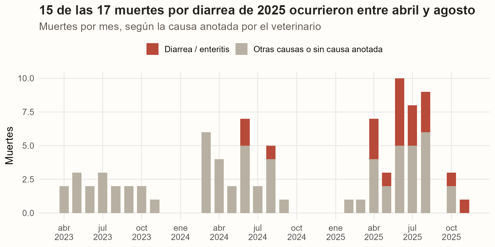
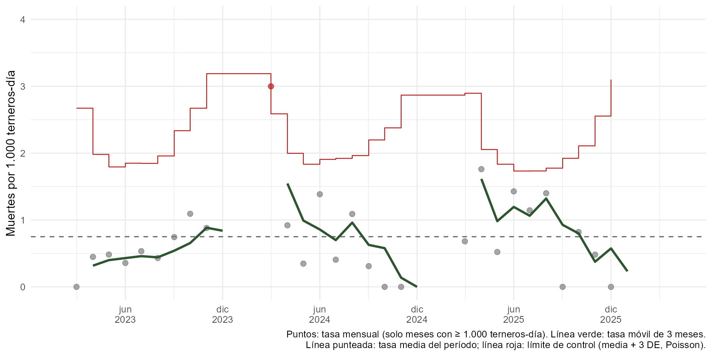
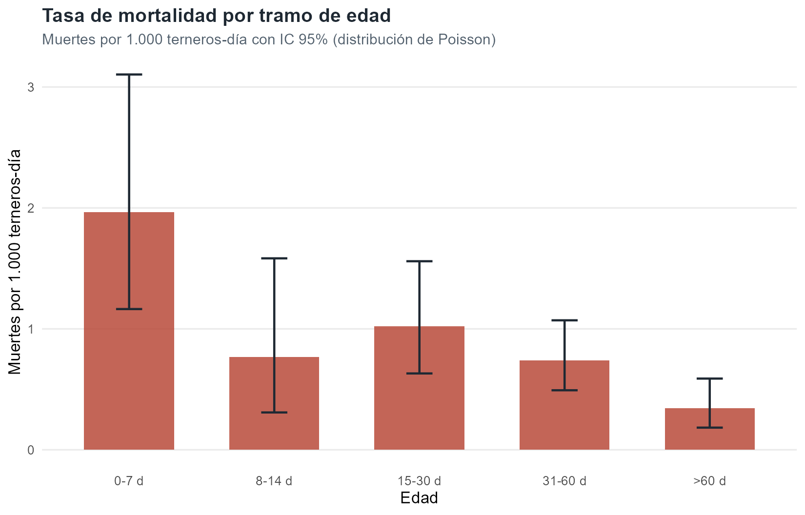
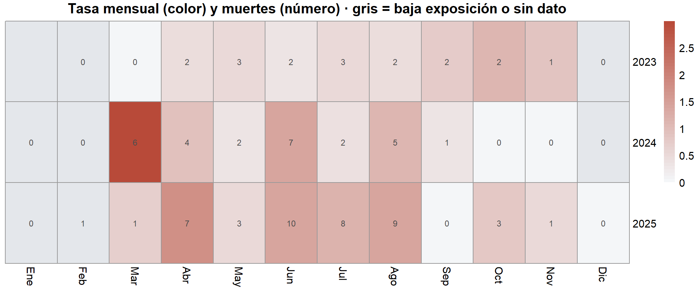
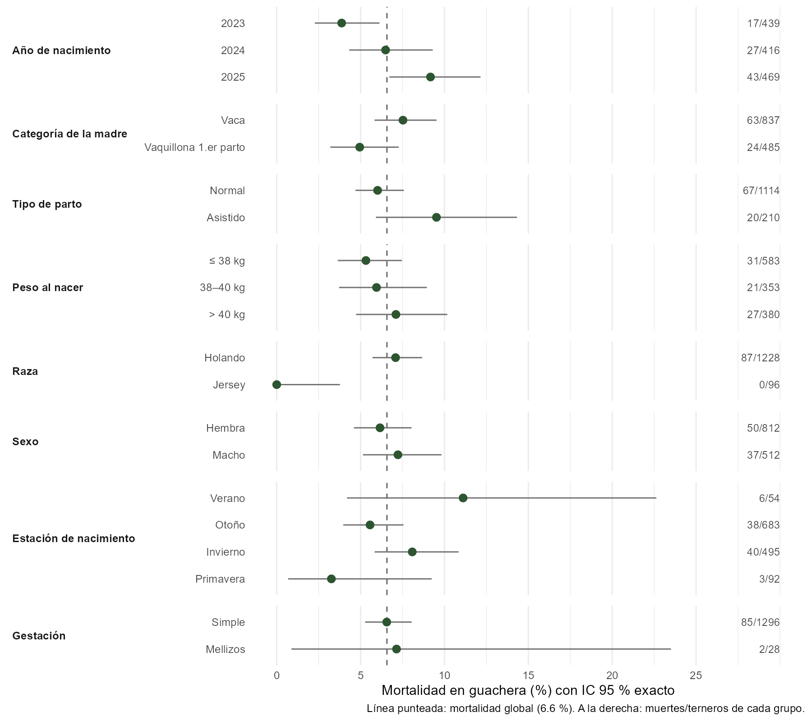

### Supervivencia y modelos

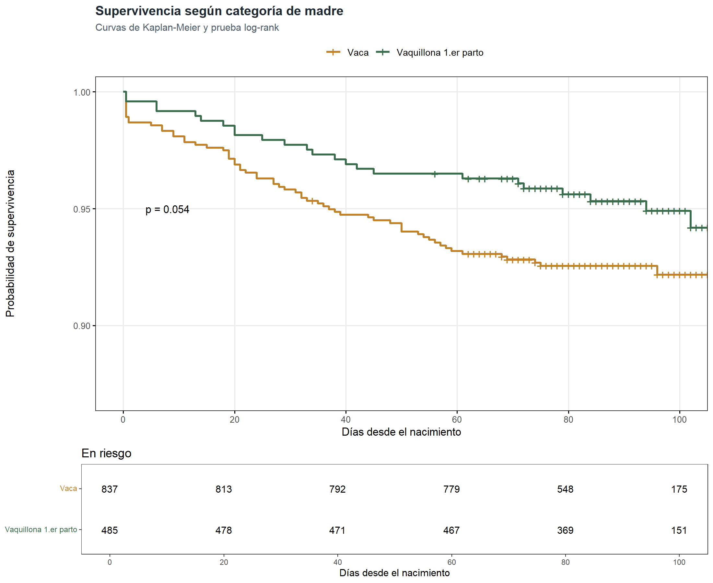
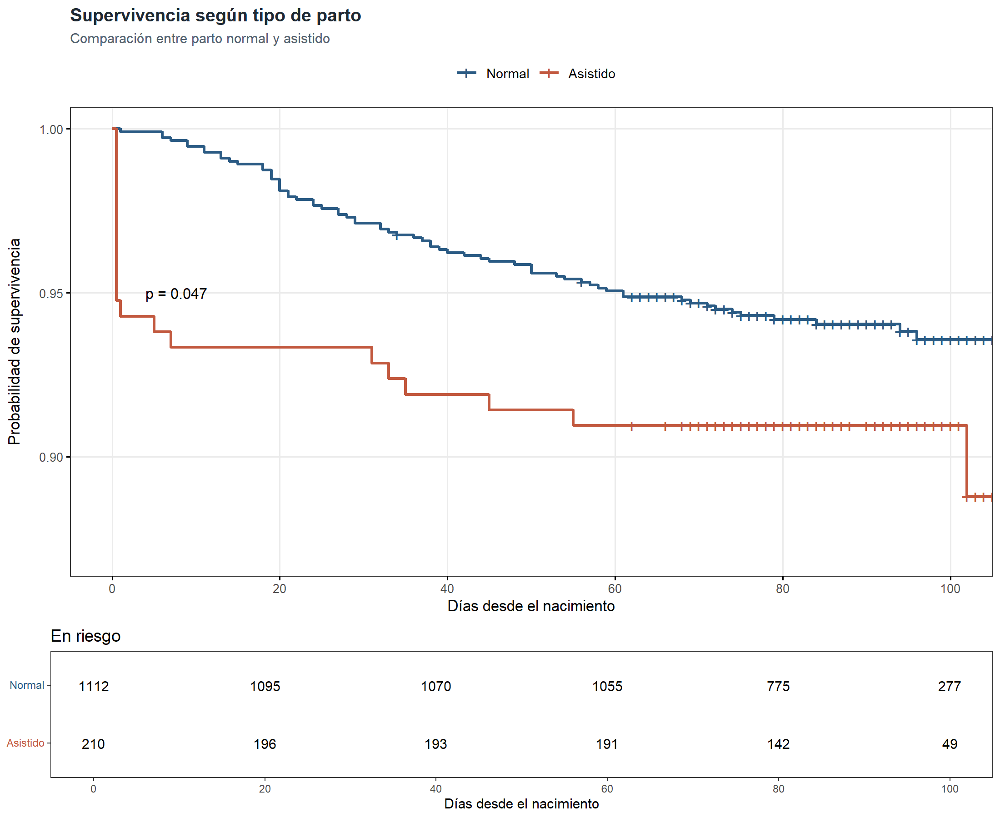
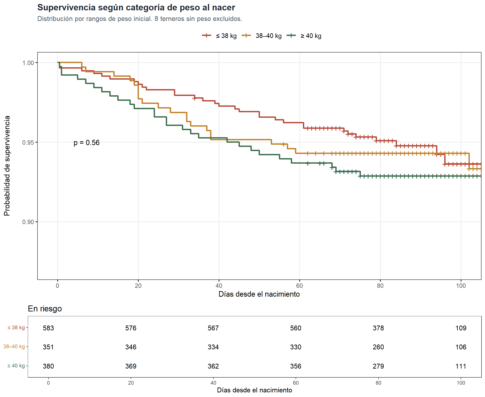
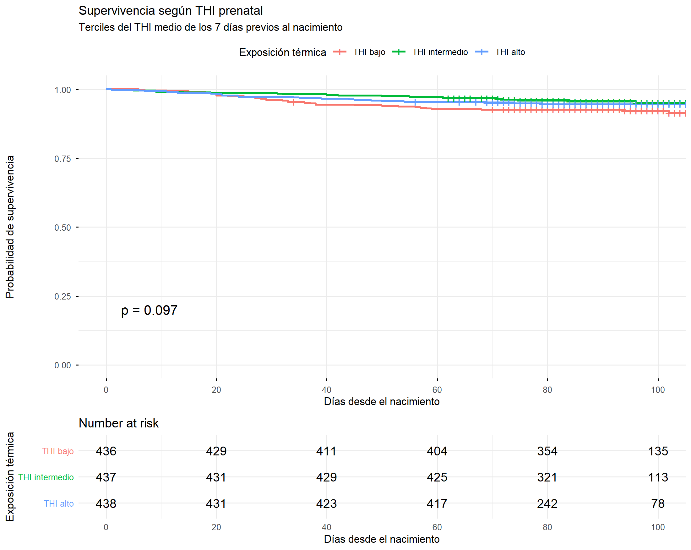
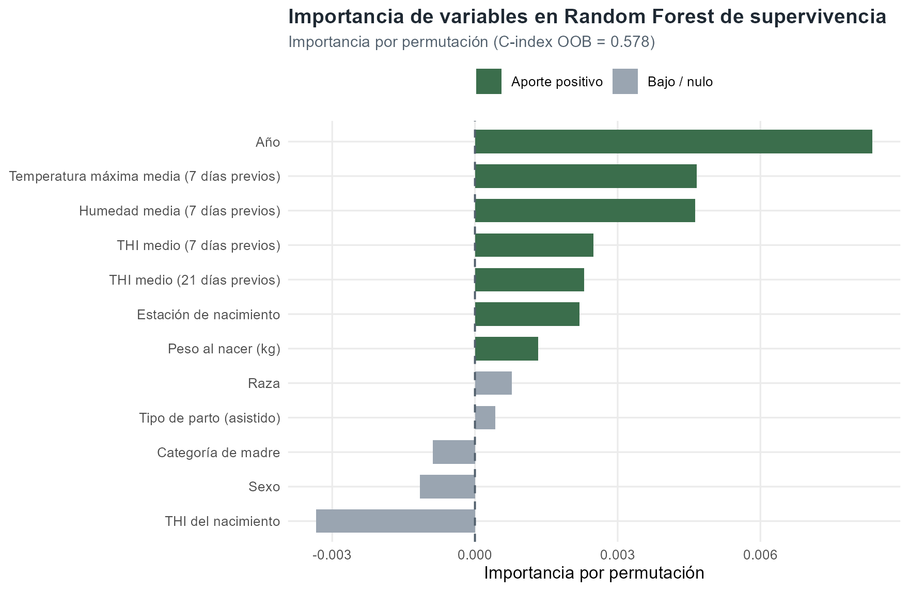

### Clima y THI

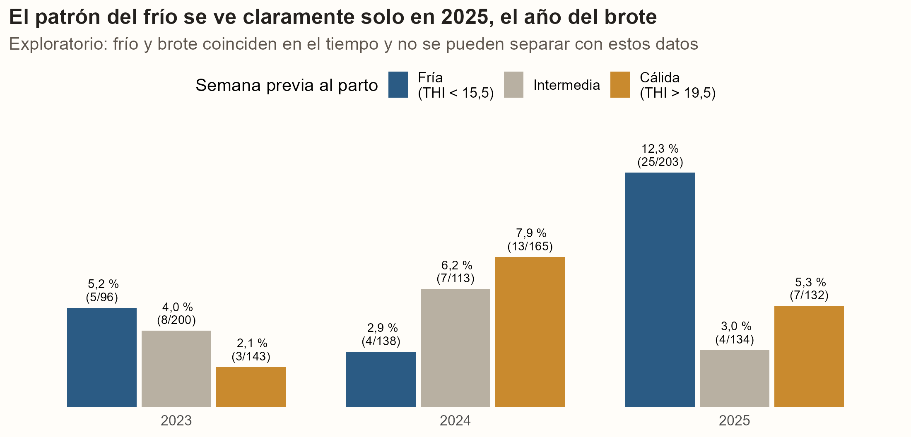