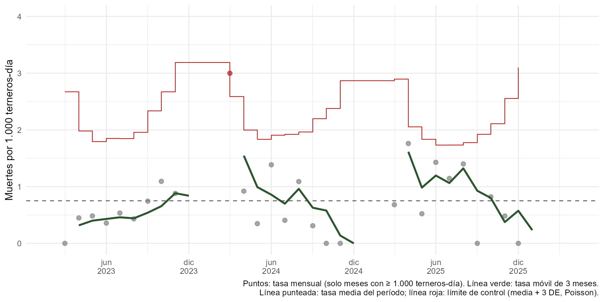
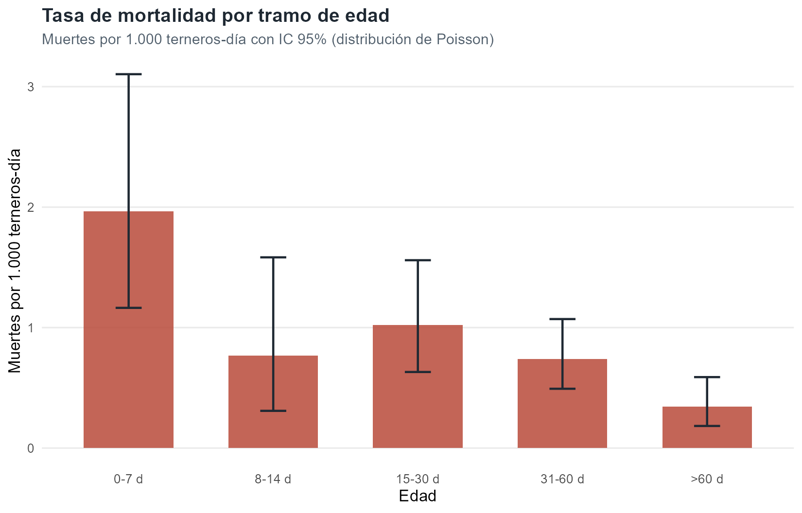
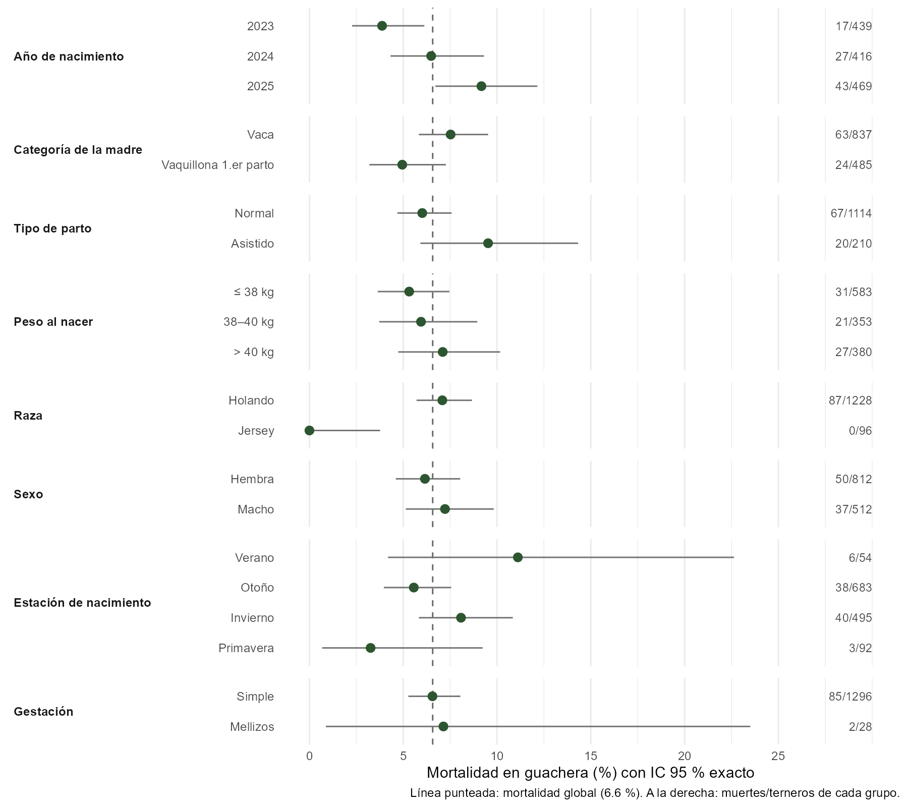
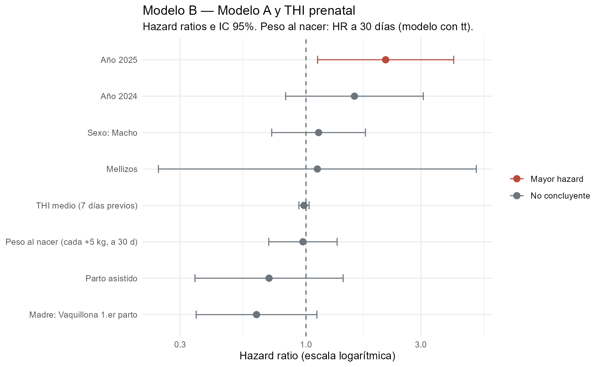
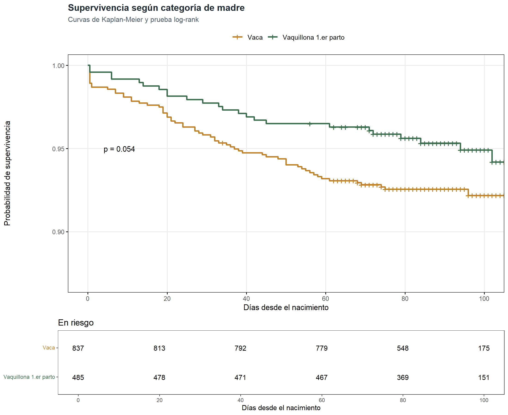
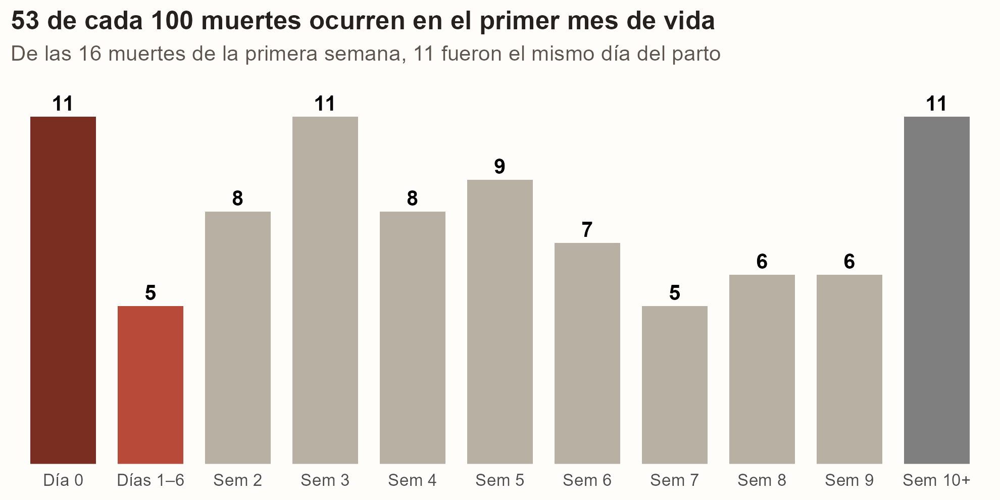
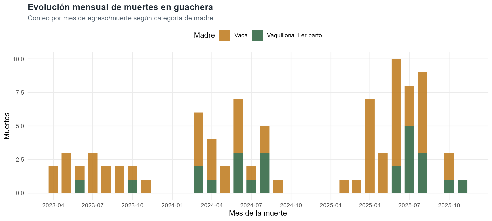
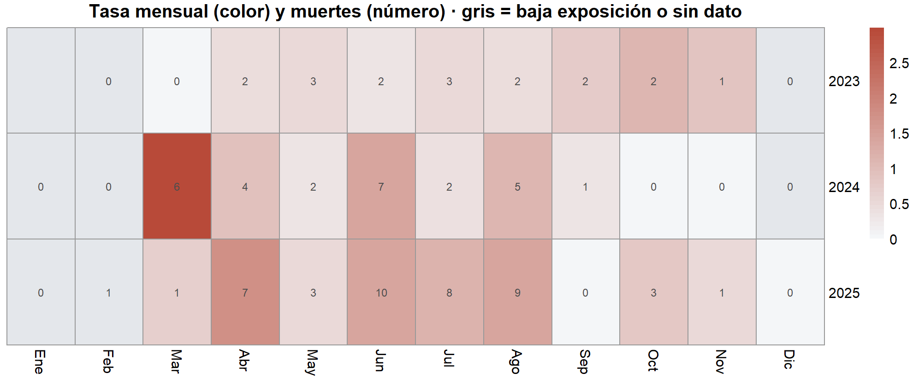

```{r}
#| include: false
library(dplyr); library(readr); library(knitr)
v  <- read_csv("data/clean/terneros_supervivencia.csv", show_col_types = FALSE)
tm <- read_csv("data/clean/powerbi/tasa_mensual.csv", show_col_types = FALSE)
riesgo <- read_csv("reports/tables/riesgo_por_tramo.csv", show_col_types = FALSE)
cox <- read_csv("reports/tables/cox_modelos.csv", show_col_types = FALSE)
```

# Resumen

## Row {height="22%"}

```{r}
#| content: valuebox
#| title: "Terneros nacidos vivos"
list(icon = "clipboard-data", color = "primary", value = format(nrow(v), big.mark = "."))
```

```{r}
#| content: valuebox
#| title: "Muertes"
list(icon = "heartbreak", color = "danger", value = sum(v$muerte))
```

```{r}
#| content: valuebox
#| title: "Mortalidad en guachera"
list(icon = "percent", color = "warning", value = paste0(round(100 * mean(v$muerte), 1), " %"))
```

```{r}
#| content: valuebox
#| title: "Meses sobre el límite de control"
list(icon = "exclamation-triangle", color = "danger", value = sum(tm$fuera_control, na.rm = TRUE))
```

## Row {height="78%"}

### Column {width="60%"}

```{r}
#| title: "Tasa mensual de mortalidad (por 1.000 terneros-día)"

```

### Column {width="40%"}

```{r}
#| title: "¿Cuándo se concentra el riesgo?"

```

# Factores de riesgo

## Row

```{r}
#| title: "Mortalidad por grupo (IC 95 %)"

```

```{r}
#| title: "Hazard ratios ajustados (Cox, modelo B)"

```

# Supervivencia

## Row

```{r}
#| title: "Supervivencia según categoría de la madre"

```

```{r}
#| title: "Edad a la muerte"

```

# Brotes y recomendaciones

## Row

```{r}
#| title: "Muertes por semana"

```

```{r}
#| title: "Mapa de calor mensual"

```

## Row {height="30%"}

::: {.card title="Qué haría el tambo"}
- Activar una alerta cuando la tasa mensual supere el límite de control.
- Registrar por ternero: hora y volumen de calostro, Brix, diarreas, tratamientos y causa de muerte.
- Revisar manejo en las etapas con mayor riesgo (completar con tus resultados).
:::
